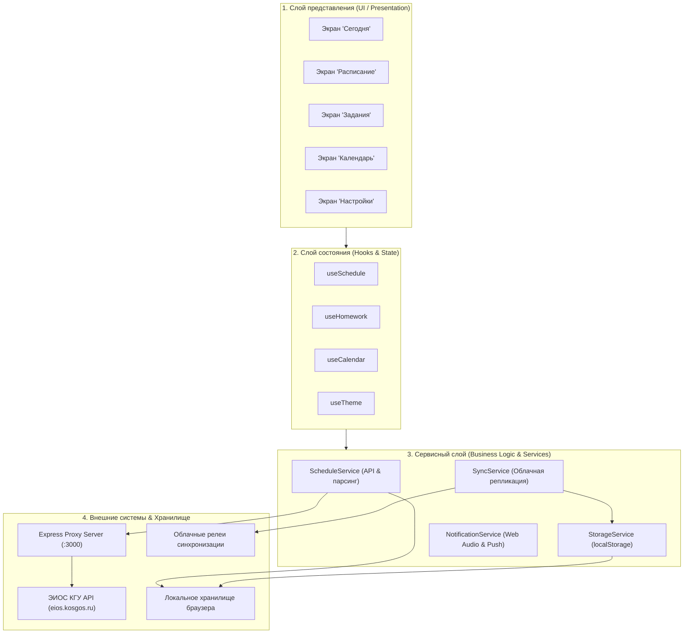

# 🏛️ Архитектура проекта «КГУ Студент»

Веб-приложение для студентов Костромского государственного университета (КГУ), объединяющее актуальное расписание учебных занятий и менеджер домашних заданий. Построено по модульной компонентной архитектуре на стеке **React 18 + TypeScript + Vite + Tailwind CSS** с поддержкой **PWA** (Progressive Web App) и многоуровневой синхронизации данных.

---

## 🛠 Технологический стек

- **Frontend Core**: React 18, TypeScript 5, Vite 6
- **Стилизация & UI**: Tailwind CSS 3, Lucide React (иконки), кастомные дизайн-токены в стиле Apple HIG
- **Offline & PWA**: Service Worker (`public/sw.js`), Web App Manifest (`public/manifest.json`), `localStorage`
- **Backend / Proxy**: Node.js, Express 4 (обход CORS к API ЭИОС КГУ и раздача статики)
- **Синхронизация**: WebSockets / SSE / MQTT / Firebase Cloud Relay, двухсторонняя репликация с разрешением конфликтов через tombstones
- **Тестирование**: Vitest

---

## 📂 Структура проекта

```
Rasp/
├── public/                         # Статические ресурсы PWA
│   ├── icon.svg                    # Векторная иконка приложения
│   ├── manifest.json               # Манифест Progressive Web App
│   └── sw.js                       # Service Worker (кэширование и offline-first навигация)
├── server/
│   └── server.js                   # Express сервер-прокси (CORS bypass к API КГУ) и static file server
├── src/
│   ├── components/                 # UI-компоненты
│   │   ├── calendar/               # Модуль календаря (сетка месяца, панель дня, добавление событий)
│   │   ├── homework/               # Модуль ДЗ (карточки, фильтры статусов, форма, чек-листы подзадач)
│   │   ├── schedule/               # Модуль расписания (недельная сетка, карточки пар, выбор групп)
│   │   ├── settings/               # Экран настроек (темы, шрифты, экспорт/импорт, синхронизация)
│   │   ├── today/                  # Экран «Сегодня» (баннер текущей пары, статистика, хронология дня)
│   │   └── ui/                     # Базовые UI-компоненты (Sidebar, MobileNav, Modal, Badge, Toast, Button)
│   ├── data/
│   │   ├── initialSchedule.json    # Встроенный офлайн-снимок расписания семестра
│   │   └── ksuGroups.json          # База групп и идентификаторов институтов КГУ
│   ├── hooks/                      # Пользовательские React-хуки
│   │   ├── useCalendar.ts          # Состояние календаря и событий
│   │   ├── useHomework.ts          # CRUD-операции и фильтрация домашних заданий
│   │   ├── useSchedule.ts          # Загрузка, фильтрация (подгруппы, языки) и кэширование пар
│   │   └── useTheme.ts             # Управление визуальными темами, шрифтами и акцентными цветами
│   ├── services/                   # Сервисный слой приложения
│   │   ├── notificationService.ts  # Web Notifications API и звуковой синтезатор Web Audio API
│   │   ├── realtimeSync.ts         # Real-time WebSockets / MQTT / Firebase синхронизация
│   │   ├── scheduleService.ts      # Взаимодействие с API ЭИОС КГУ и локальным кэшем
│   │   ├── storageService.ts       # Управление локальным хранилищем (localStorage) с безопасными квотами
│   │   └── syncService.ts          # Двухсторонняя облачная репликация между устройствами (PC <-> Phone)
│   ├── types/                      # TypeScript-интерфейсы и схемы данных
│   │   ├── calendar.ts             # Типы событий календаря
│   │   ├── homework.ts             # Спецификация домашних заданий, приоритетов и подзадач
│   │   ├── schedule.ts             # Модели пар, аудиторий, преподавателей и дней
│   │   └── settings.ts             # Конфигурация тем, шрифтов и профиля пользователя
│   ├── utils/                      # Вспомогательные утилиты
│   │   ├── dateUtils.ts            # Форматирование и локализация дат, расчет четности недели
│   │   ├── icsExport.ts            # Генерация файлов iCalendar (.ics) для системных календарей
│   │   ├── scheduleParser.ts       # Нормализация данных из формата ЭИОС КГУ
│   │   └── version.ts              # Метаданные текущей версии приложения
│   ├── App.tsx                     # Корневой компонент: координация маршрутизации и модальных окон
│   ├── index.css                   # Глобальные стили, темы Tailwind и скроллбары
│   ├── main.tsx                    # Точка монтирования React 18 (Root)
│   └── vite-env.d.ts               # Типизация окружения Vite
├── tests/                          # Модульные тесты (Vitest)
│   ├── customization.test.ts       # Тесты логики тем и шрифтов
│   ├── dateUtils.test.ts           # Тесты парсинга дат и недель
│   ├── scheduleParser.test.ts      # Тесты парсера расписания КГУ
│   └── storageService.test.ts      # Тесты квотирования и персистентности данных
├── index.html                      # HTML-контейнер и метатеги
├── package.json                    # Манифест зависимостей и npm-скриптов
├── postcss.config.js               # Конфигурация PostCSS
├── tailwind.config.js              # Конфигурация темы Tailwind CSS
├── tsconfig.json                   # Настройки компилятора TypeScript
└── vite.config.ts                  # Конфигурация сборщика Vite
```

---

## 🏛️ Архитектурные уровни



1. **Presentation Layer (Компоненты интерфейса)**:
   - Модули независимы друг от друга, оформлены по гайдлайнам Apple HIG (скругления, акцентные цвета, тактильный отклик, плавающие навигационные панели).
   - Адаптивность: боковая панель (Sidebar) для компьютеров и нижний Dock (MobileNav) для мобильных устройств.

2. **State & Hooks Layer (Управление состоянием)**:
   - Инкапсулирует бизнес-логику и реактивное состояние компонентов.
   - Обеспечивает фильтрацию пар по подгруппам (1/2 пг) и иностранным языкам, фильтрацию дедлайнов ДЗ, расчет прогресса подзадач.

3. **Services & Persistence Layer (Сервисы и хранение)**:
   - **Offline-First**: все пользовательские данные (задачи, события, настройки) сохраняются в `localStorage` и мгновенно доступны без интернета.
   - **Safe Quota**: контроль объема локального хранилища и защита от переполнения.
   - **Tombstone Sync**: двухсторонняя синхронизация с предотвращением воскрешения удаленных задач при слиянии состояний.

4. **Integration Layer (Интеграция с КГУ)**:
   - Запросы к REST API КГУ проходят через локальный сервер-прокси (`server/server.js`) для прозрачного обхода политики CORS.
   - При недоступности сервера КГУ автоматически активируется резервный офлайн-снимок расписания.

---

## 📄 Лицензионное соглашение (License)

Данный проект распространяется под условиями открытой лицензии **MIT License**.

```
MIT License

Copyright (c) 2026 fimaking

Permission is hereby granted, free of charge, to any person obtaining a copy
of this software and associated documentation files (the "Software"), to deal
in the Software without restriction, including without limitation the rights
to use, copy, modify, merge, publish, distribute, sublicense, and/or sell
copies of the Software, and to permit persons to whom the Software is
furnished to do so, subject to the following conditions:

The above copyright notice and this permission notice shall be included in all
copies or substantial portions of the Software.

THE SOFTWARE IS PROVIDED "AS IS", WITHOUT WARRANTY OF ANY KIND, EXPRESS OR
IMPLIED, INCLUDING BUT NOT LIMITED TO THE WARRANTIES OF MERCHANTABILITY,
FITNESS FOR A PARTICULAR PURPOSE AND NONINFRINGEMENT. IN NO EVENT SHALL THE
AUTHORS OR COPYRIGHT HOLDERS BE LIABLE FOR ANY CLAIM, DAMAGES OR OTHER
LIABILITY, WHETHER IN AN ACTION OF CONTRACT, TORT OR OTHERWISE, ARISING FROM,
OUT OF OR IN CONNECTION WITH THE SOFTWARE OR THE USE OR OTHER DEALINGS IN THE
SOFTWARE.
```
